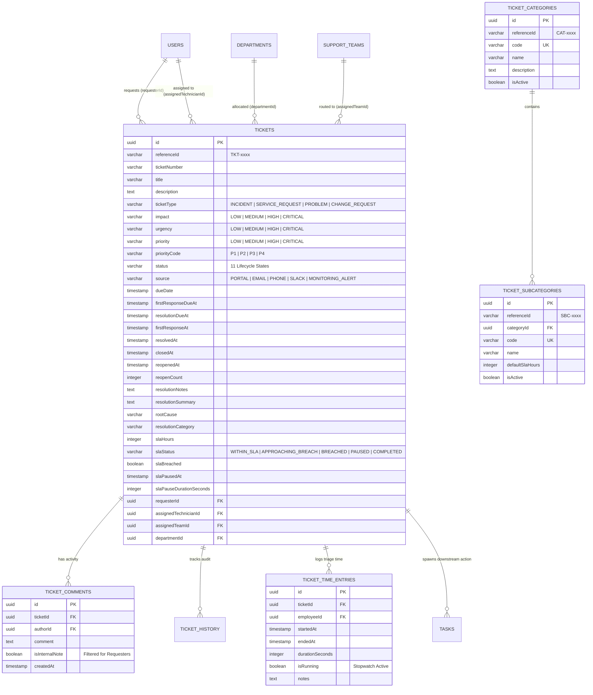

# Q Clocker Enterprise IT Service Management (ITSM) Architecture

## 1. Executive Summary & ITIL Alignment
The Q Clocker Enterprise IT Service Management (ITSM) module provides ITIL v4-aligned incident management, service request fulfillment, problem resolution, change tracking, dynamic SLA calculations, and priority matrices. It is engineered within the Q Clocker modular monolithic architecture, maintaining strict logical and physical time-decoupling across:
- **Work Shifts & Attendance Events** (`attendance_events`)
- **Active User Sessions** (`work_sessions`)
- **Engineering Task Timers** (`task_time_entries`)
- **ITSM Triage Stopwatch Logs** (`ticket_time_entries`)
- **Payroll & Billing Timesheets** (`timesheets`)

---

## 2. Domain Models & Relational Architecture

### 2.1 Entity Relationship Diagram

---

## 3. Core Architectural Modules

### 3.1 State Machine Engine (`TicketStateMachineService`)
- Enforces an immutable transition matrix across all 11 lifecycle statuses.
- Prevents illegal leaps (e.g., jumping from `NEW` directly to `RESOLVED` without triage).
- Enforces role-based permissions (only IT Managers/Admins can reopen closed tickets; only Admins can revive cancelled tickets).
- Enforces mandatory resolution documentation (`resolutionNotes` and `rootCause`) prior to marking status as `RESOLVED`.

### 3.2 Dynamic SLA Engine (`TicketSlaService`)
- **Priority Matrix**: Maps `Impact` $\times$ `Urgency` to ITIL priority codes (`P1` through `P4`).
- **Target Deadlines**: Computes initial deadlines for first response and resolution targets.
- **Dynamic Clock Evaluation**: Calculates live remaining minutes, elapsed percentage, and breach threshold warnings (triggers `APPROACHING_BREACH` when $\ge 75\%$ consumed).
- **Pause/Resume Mechanism**: Automatically freezes the SLA clock when tickets enter external wait states (`PENDING_USER`, `PENDING_VENDOR`, `ON_HOLD`), accumulating pause seconds upon resume.

### 3.3 Security & Note Segregation
- Role-based authorization via `JwtAuthGuard` and `RolesGuard`.
- Confidentiality boundary: Any comment flagged with `isInternalNote: true` is strictly filtered out server-side when requested by an employee requester.

### 3.4 Bi-directional Task Integration
- Enables technicians to spin off dedicated remediation tasks from an active incident (`POST /tickets/:id/tasks`).
- Enables technicians to link existing tasks (`POST /tickets/:id/link-task`).
- Maintains complete operational independence: resolving an incident does not prematurely cancel tasks, and completing a task does not close an incident without verification.

