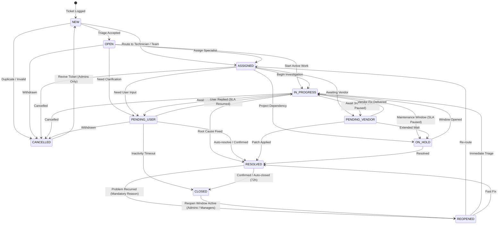

# Q Clocker Ticket Lifecycle & State Transition Matrix

## 1. Lifecycle State Machine Diagram

---

## 2. Comprehensive Transition Matrix Table

| Origin Status | Permitted Destination Statuses | Role Requirements | Mandatory Conditions / Side Effects |
|---|---|---|---|
| `NEW` | `OPEN`, `ASSIGNED`, `CANCELLED` | All authenticated roles | Initial creation state; SLA clock starts ticking. |
| `OPEN` | `ASSIGNED`, `IN_PROGRESS`, `PENDING_USER`, `CANCELLED` | Technicians, Managers, Admins | First response timestamp captured if technician replies. |
| `ASSIGNED` | `IN_PROGRESS`, `PENDING_USER`, `PENDING_VENDOR`, `ON_HOLD`, `CANCELLED` | Assigned Technician, Managers, Admins | Assignee notified; SLA countdown continues. |
| `IN_PROGRESS` | `PENDING_USER`, `PENDING_VENDOR`, `ON_HOLD`, `RESOLVED`, `CANCELLED` | Assigned Technician, Managers, Admins | Stopwatch timer can be engaged. `RESOLVED` requires root cause and fix notes. |
| `PENDING_USER` | `IN_PROGRESS`, `RESOLVED`, `CLOSED`, `CANCELLED` | Requester or Technicians | **SLA Clock Paused**. Resuming to `IN_PROGRESS` unpauses clock and accumulates pause seconds. |
| `PENDING_VENDOR` | `IN_PROGRESS`, `RESOLVED`, `ON_HOLD`, `CANCELLED` | Technicians, Managers, Admins | **SLA Clock Paused**. Requires external ticket reference or reason. |
| `ON_HOLD` | `IN_PROGRESS`, `RESOLVED`, `CANCELLED` | Technicians, Managers, Admins | **SLA Clock Paused**. Used for scheduled maintenance windows. |
| `RESOLVED` | `CLOSED`, `REOPENED` | Requesters (to Reopen), Technicians, Admins | SLA marked `COMPLETED`. 72-hour customer confirmation timer starts. |
| `CLOSED` | `REOPENED` | IT Managers, Admins | Terminal archived state. Reopening requires justification and increments `reopenCount`. |
| `REOPENED` | `ASSIGNED`, `IN_PROGRESS`, `PENDING_USER`, `RESOLVED`, `CANCELLED` | Technicians, Managers, Admins | Reopening reason logged; audit history event appended. |
| `CANCELLED` | `NEW` (Revival) | Super Admin, System Administrator only | Cancellation reason mandatory. |

---

## 3. Validation & Business Rule Enforcement

### 3.1 Mandatory Resolution Rules
A ticket **cannot** transition to `RESOLVED` unless:
1. `resolutionNotes` is provided with $\ge 5$ characters describing the permanent fix or workaround.
2. `rootCause` is specified for incident post-mortem tracking.
3. Any running stopwatch timer on the ticket is automatically stopped.

### 3.2 Mandatory Reopening Rules
A ticket **cannot** transition to `REOPENED` unless:
1. `reason` is provided with $\ge 5$ characters explaining why the prior resolution failed.
2. `reopenCount` is automatically incremented.
3. `reopenedAt` timestamp is stamped.
4. `resolvedAt` and `resolutionNotes` are cleared to reflect active investigation status.
